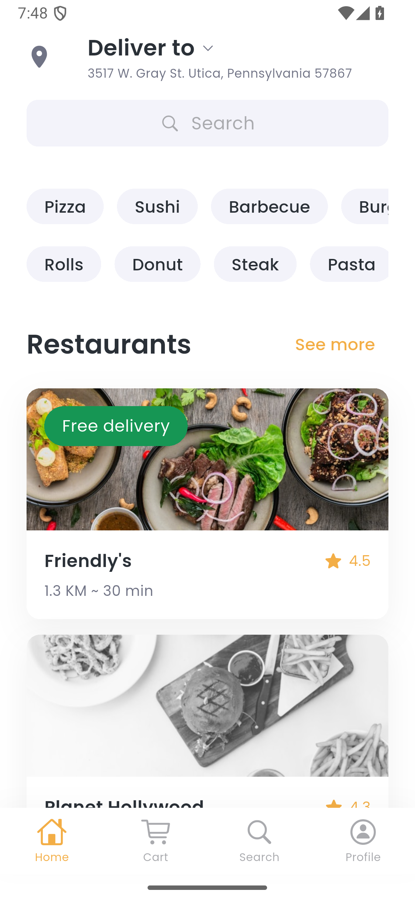
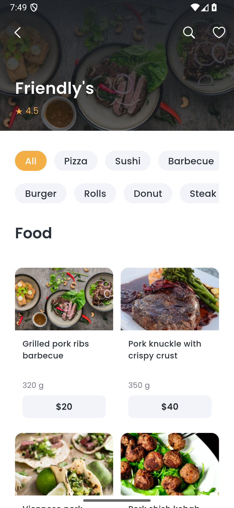
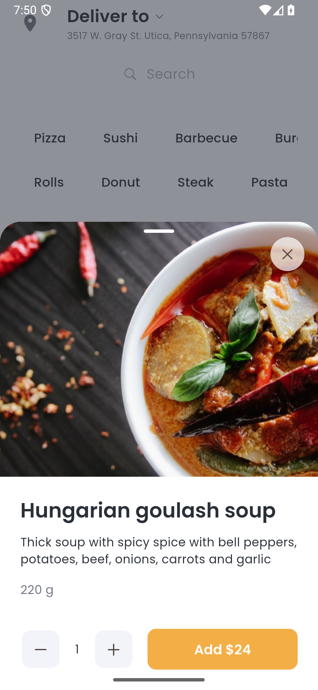
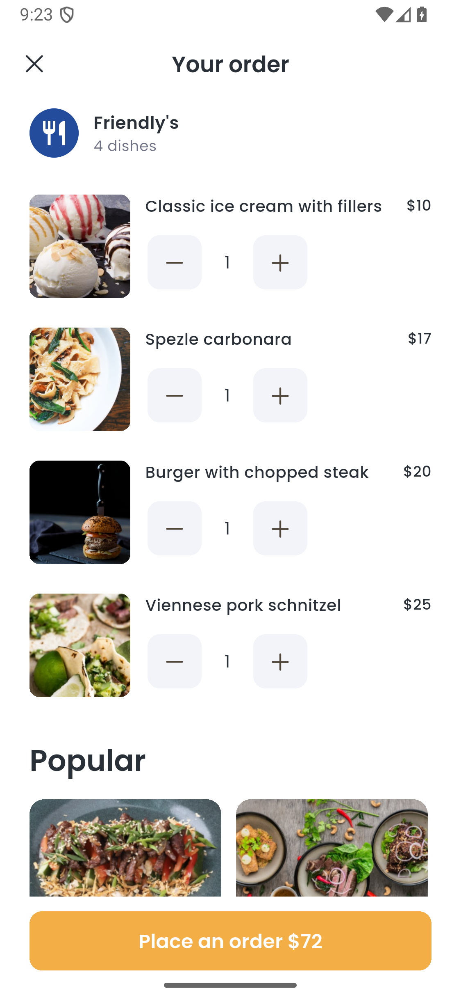
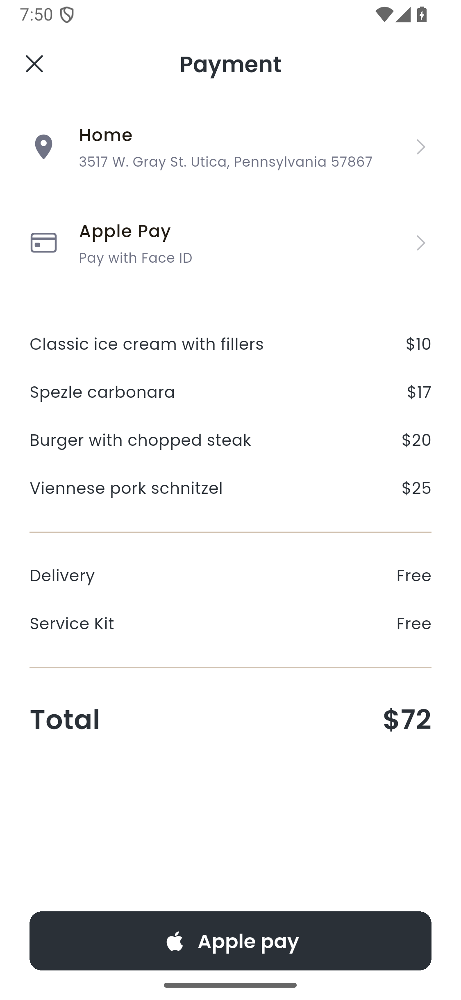
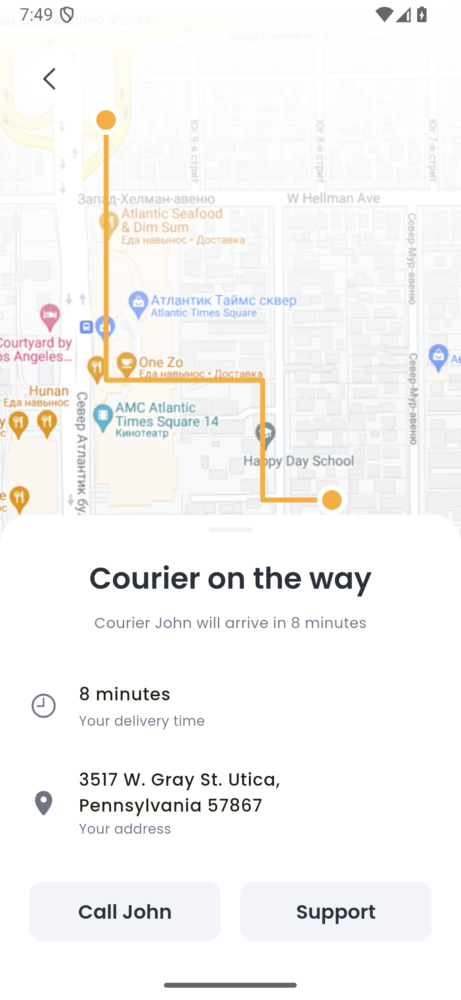
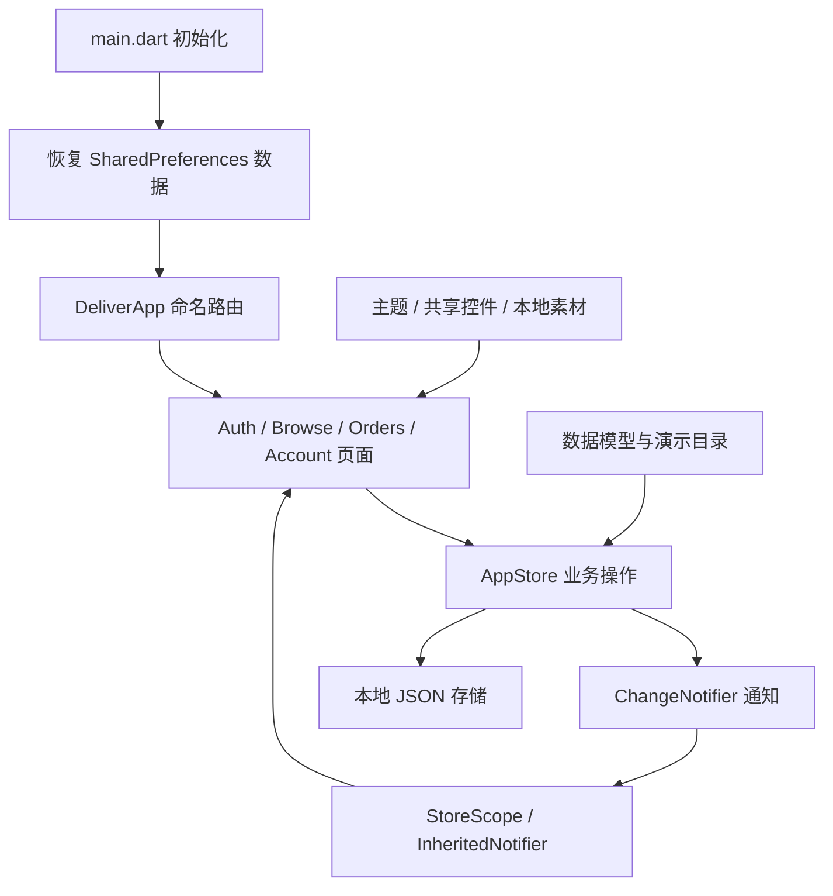

# Deliver.io 项目说明与架构

## 1. 设计来源与实现范围

来源为 Pixso 文件 **Deliver.IO in BOX+**，包括以下分类：

| 分类 | 读取内容 | 实现用途 |
| --- | --- | --- |
| Screens（`0:1`） | 51 个顶层界面和状态 | 页面布局、文案、流程及截图对应 |
| Components（`1:23`） | Components、Typography、Icons、Colors | 字体、色彩、组件尺寸和视觉样式 |

完整节点 ID、名称、尺寸和文本记录于 [pixso-inventory.json](pixso-inventory.json)，逐页对应见 [SCREEN_INDEX.md](SCREEN_INDEX.md)。原设计文件没有被修改。

项目以可运行、可交互的 Android UI 演示为主要交付，同时提供 iOS 和 Web 工程。界面保留原稿英文，文档使用中文。重复设计状态合并为可复用页面，输入时由系统显示真实键盘；长页面通过滚动展示。

## 2. 主要界面

### 发现餐厅与挑选菜品

首页包括配送地址、分类、餐厅、热门菜品与推荐餐厅。菜单使用双列卡片；菜品详情可以调整份数和加购。

| 首页 | 餐厅菜单 | 菜品详情 |
| --- | --- | --- |
|  |  |  |

### 从购物车到配送

购物车支持多菜品、数量调整与移除。结算允许选择地址和支付方式；演示支付成功创建订单并清空购物车，失败保留购物车供重试。

| 多菜品购物车 | 结算 | 配送追踪 |
| --- | --- | --- |
|  |  |  |

## 3. 功能覆盖

| 模块 | 功能 | 状态 |
| --- | --- | --- |
| 身份与引导 | 手机格式校验、国家区号搜索、验证码校验、重发倒计时、三页引导 | 空输入、已输入、错误码、键盘 |
| 浏览 | 餐厅详情、分类菜单、菜品详情、加购、份数调整、热门列表 | 首页长列表、菜单、菜品详情 |
| 搜索 | 菜品名称/分类匹配、餐厅名称匹配、搜索历史与清空 | 双标签、输入、结果、无结果 |
| 购物车与支付 | 数量调整、移除、账单、优惠、地址/支付方式选择、模拟付款 | 空、单菜品、多菜品、成功、失败 |
| 订单 | Active/History、继续结算、再来一单、配送路线、评分与评价保存 | 无订单、待结算、配送中、历史、评价输入 |
| 账户 | 姓名/邮箱/手机编辑、表单校验、改号验证、退出 | 编辑、保存、验证码 |
| 银行卡 | 手工添加、格式校验、选择、删除 | 无卡、有卡、编辑、添加、扫描预览 |
| 地址 | 添加、编辑、删除、选择、查询、地图选点演示、配送备注 | 列表、详情、输入、地图 |
| 更多 | 三种通知偏好、邀请代码复制、FAQ | 开关本地保存、折叠问答 |

51 张对应截图记录实际页面视窗。原稿中的 Full Home、Popular、Search 和多菜品购物车等长页保留滚动内容，没有将长稿压缩成单屏。历史订单与卡片截图由集成测试建立演示数据；新安装不会自动生成这些记录。

## 4. 项目目录

```text
Deliver_ioFoodDelivery/
├── lib/
│   ├── main.dart
│   ├── app.dart
│   ├── core/
│   │   ├── theme.dart
│   │   └── widgets.dart
│   ├── data/
│   │   ├── catalog.dart
│   │   └── app_store.dart
│   └── features/
│       ├── auth/auth_screens.dart
│       ├── browse/browse_screens.dart
│       ├── orders/order_screens.dart
│       └── account/account_screens.dart
├── assets/
│   ├── fonts/                 # Poppins 三种字重与 OFL 字体许可
│   └── images/                # Pixso 照片、插画、地图、标识
├── android/                   # Android 宿主和构建配置
├── ios/                       # iOS 宿主，需 macOS 验证
├── web/                       # Web 宿主
├── test/                      # 状态规则与本地存储测试
├── integration_test/          # Android 交互、布局与状态巡检
├── test_driver/               # 集成截图驱动
├── tool/capture_android.py    # 含系统栏与键盘的实际截图
├── docs/
│   ├── design-reference/      # Pixso 导出图与总览
│   ├── screenshots/           # 实际 App 截图与总览
│   ├── validation/            # 验证日志
│   ├── pixso-inventory.json
│   ├── SCREEN_INDEX.md
│   ├── VALIDATION.md
│   └── PROJECT_GUIDE.md
├── deliverables/              # 安装包
├── pubspec.yaml
├── pubspec.lock
└── README.md
```

## 5. 架构与数据流

采用按功能组织的轻量结构：页面处理展示和交互，`AppStore` 处理跨页业务状态，`catalog.dart` 定义模型与目录，`core` 集中提供共享视觉规则。



- **启动**：初始化 Flutter、状态栏和本地数据；启动画面后进入登录或首页。
- **路由**：`app.dart` 统一维护命名路由及参数。首页使用 `IndexedStack` 保留 Home、Cart、Search、Profile 标签状态。
- **状态管理**：`AppStore extends ChangeNotifier` 管理购物车、订单、地址、卡片尾号、资料、搜索历史和通知。`StoreScope` 通过原生 `InheritedNotifier` 分发变化。
- **本地保存**：状态保存为 `deliver_io` JSON；处理格式错误和缺省字段；地址列表至少保留一条。评价单独保存为 `last_review`。
- **模型**：`Food`、`Restaurant`、`DeliveryAddress`、`SavedOrder`。订单保存独立的菜品数量快照和实际支付金额，后续购物车变化不影响原订单。
- **精简方式**：按钮、卡片、表单、分类、数量选择器和列表项均复用；不引入额外状态、路由或网络框架，不包含默认计数器代码。

### 主要路由

| 流程 | 路由 |
| --- | --- |
| 身份 | `/login`、`/register`、`/country`、`/sms`、`/onboarding` |
| 浏览 | `/home`、`/restaurants`、`/popular`、`/restaurant`、`/product` |
| 搜索 | `/search-action`、`/search-results`、`/search-food` |
| 交易 | `/cart`、`/payment`、`/success`、`/failure`、`/tracker`、`/rate` |
| 账户 | `/profile-edit`、`/sms-change`、`/cards`、`/add-card`、`/scan-card` |
| 地址及偏好 | `/addresses`、`/address-edit`、`/address-new`、`/location`、`/map`、`/notifications`、`/refer`、`/faq` |

### 金额规则

金额为整数美元。单价乘数量得到小计；总份数为 1 时应用演示优惠 $3，多份不应用。配送与 Service Kit 免费。付款按钮、账单与订单使用一致的支付金额。

单菜品原稿存在购物车 $25、结算 $24 的差异；实现统一使用目录价 $25，优惠后 $22。多菜品状态总额 $72 与参考一致。

## 6. 设计规范与素材

主色从组件实际填充读取，为 `#F3AE46`；色板文字中残留的旧色值未采用。文字色 `#2A3037`，浅色背景 `#F3F3FA`，页面边距约 24 逻辑像素，圆角约 10–12 像素。

Poppins Regular、Medium、SemiBold 本地内置，运行无需下载。餐厅、菜品、3D 插画和地图直接从 Pixso 导出；源品牌标识用于启动页和平台图标。原稿部分菜名与照片并不对应，本实现沿用源图；为演示所有分类，少量补充目录项复用了源素材。

## 7. 运行与操作

验证环境为 Flutter **3.47.7**、Dart **3.13.5**、Android 15 / API 35 模拟器。截图为 1125 × 2436 像素，375 × 812 逻辑尺寸；系统栏与键盘采用平台实际行为。

```sh
flutter pub get
flutter run -d emulator-5554
```

输入至少 7 位手机号，演示验证码为 **1234**。完成引导后选择餐厅、添加菜品并结算。付款对话框标注 Demo payment，允许模拟成功/失败。成功后到 Cart → Active → Track order 查看配送示意。

## 8. 验证与截图

```sh
flutter analyze
flutter test
flutter drive -d emulator-5554 --driver test_driver/screenshots.dart --target integration_test/app_flow_test.dart
python tool/capture_android.py --device emulator-5554

# 只刷新指定编号
python tool/capture_android.py --only 01,02,44,45
```

截图工具依次进入 51 个设计状态，检查 Flutter 异常，再捕获包含键盘和系统栏的 Android 屏幕。`test_driver/screenshots.dart` 也支持独立导出 Flutter 画布截图。详细结果见 [VALIDATION.md](VALIDATION.md)。

## 9. 构建与交付

```sh
flutter build apk --release
flutter build web --release
```

Android 包位于 `deliverables/DeliverIO-demo.apk`，使用默认调试签名进行 release 构建；正式发布前需配置正式签名。本机已有全局构建目录设置，因此此次 Web 产物位于 `build_temp/web/`；未自定义构建目录时通常为 `build/web/`。应通过静态服务打开 Web 产物。iOS 工程已提供，但 Windows 无法编译验证，需要在 macOS/Xcode 配置开发团队与签名。

## 10. 真实服务接入边界

当前交付是**可交互、本地保存的 UI 演示工程**：

- 短信固定验证 `1234`；Google/Apple 登录提示需连接认证服务。
- 付款为显式模拟，不收款、不创建真实商家订单。
- 扫描页使用参考图预览并引导手工输入，不读取相机。仅保存卡号后四位，不保存完整卡号、CVV。
- 地图为设计静态底图，选点和配送路线为演示，不提供真实定位、地址反查和物流。
- 通知设置仅保存偏好，不注册推送；邀请复制演示码，不发放真实奖励。
- 商品、价格、骑手电话和配送时间均为本地数据。

后续可在 `data` 层加入认证、餐厅、订单、支付和地图服务接口，将 `AppStore` 本地操作连接到服务端，继续复用现有页面与组件。
